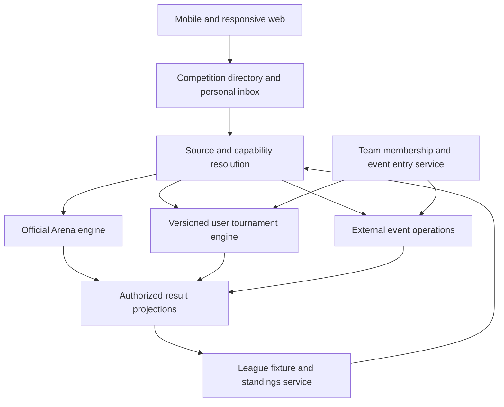

# Arène architecture and delivery plan

Date: October 18, 2026

Status: Proposed implementation specification; no competition-platform code changes in this documentation task

Source baseline: commit `e157aec621186f793a65f6cd8a58df8a86536d80`, plus the existing uncommitted diagnostics work inspected October 18

Companions: [Product](PRODUCT-SPEC.md), [Journeys](USER-JOURNEYS.md), [Experience](EXPERIENCE-SPEC.md)

## 1. Current implementation and the actual gaps

Paths below refer to the repository root. This is a source assessment, not a claim of deployed or installed-build behavior.

| Area | Existing implementation | What must change |
| --- | --- | --- |
| Web navigation | `src/App.tsx` separates `/arena`, championship/play routes, `/tournois`, creation/join/room routes and `/defi/:code` | One discovery and personal activity experience while preserving old destinations and source engine identity |
| Web Arena | `src/pages/arena/ArenaArcade.tsx` combines identity, school XP, play and links to competition destinations | Lead with actual obligations and discoverable events; school XP is explicitly secondary to event standings |
| Native discovery | `mobile/src/components/games/JeuxHub.tsx`, `ArenaHubPanel.tsx`, `ArenaHubScreen.tsx` share an Arena panel with official-event actions and everyday play | Canonical root discovery, individual user-tournament journeys, school/event/team/league destinations and a compact Jeux preview |
| Native official play | `mobile/src/hooks/useArena.ts`, `services/arenaService.ts` and `screens/arena/*` handle registration, doors, live play, watching and results | Preserve these flows behind an official-event adapter; remove assumptions that every discovered event belongs to this engine |
| User-tournament configuration | `shared/tournois/config.ts` has `live/window/rounds/bracket`, `solo/school/grade`, 3/5 counting-player choices and `public/unlisted/private` | Add explicit entry/game mode, real teams, audience/eligibility, school scope and new capabilities through a versioned schema |
| User-tournament execution | `api/tournois/{create,join,play,tick}.ts`, `_shared.ts`, shared schedule/attempt/scoring/bracket modules | Reuse safe server-owned timing/scoring primitives; add team roster/entry authority and only the mode capabilities actually supported |
| User-tournament web room | `src/pages/tournois/TournoisRoom.tsx` serves participant, creator and spectator roles | Share state derivation, provide role-specific composition and native equivalents; richer organizer operations are new work |
| Current teams | `shared/tournois/scoring.ts` groups by normalized school name or grade and uses shared best-N ranking | These are score groups, not persistent named teams, invitations or event roster snapshots |
| School identity | `shared/schools.ts`, `schoolWebService.ts`, native `schoolService.ts`, `schools` rules support canonical catalog entries/pending approval | Approved catalog identity does not prove student membership or school-organizer authority; add scoped records and approval workflows |
| User-tournament identity | `_shared.resolveIdentity` accepts a school string and allowed grade from the request; join requires a value for grouped modes | Restricted school/class/regional events require server-validated eligibility, canonical IDs and frozen event evidence |
| Personal history | `users/{uid}/myTournaments` stores creator/player references; `tournoisService.listMine` reads a bounded list | Add invitations, team drafts, followers, entry/approval state and multiple roles without discarding legacy history |
| Discovery | `tournoisService.listPublic` queries open public events (30) or finished ones (10); existing indexes cover visibility/state/start | New normalized listings, school/region projections, cursor pagination and limited supported filter combinations |
| Privacy | `firestore.rules` allows public/unlisted rooms and roster/live/standings/matches to their viewers; private rooms require creator/roster access | Viewing must become independent of admission; separate private registration/attendance/credentials from public projections |
| PIN entry | Six-digit `tournamentPins` lookup is publicly gettable; parent tournament documents include their PIN | PIN possession is not verified membership. A public-view/restricted-entry event cannot expose an admission secret in its public parent document |
| Current lifecycle | User tournaments use scheduled/running/finished/cancelled; official Arena uses draft/registration/doors/live/grading/provisional/final/void | Normalize presentation without pretending both engines have the same finality/review semantics |
| Organizer operations | Creation auto-generates questions/schedule; cancellation is creator-only before start | Drafts, scoped co-hosts, roster approval, safe rescheduling, attendance, adjudication and external reporting require implementation |
| Content | User tournaments draw from `src/data/triviaData.ts`, which also supplies client practice games | Do not claim secure unpublished exams or grade-aligned academic assessment; higher-stakes prizes/qualification require an appropriate moderated pool and validation |
| Links/onboarding | `mobile/src/navigation/arenaLinks.ts` owns Arena/duel parsing; onboarding currently recognizes duel/Arena intent; `mobile/app.json` claims selected paths | Add typed team/user-event/league invitation targets, query/credential handling, auth continuity and installed OS link coverage |
| Presentation | `src/styles/arenaNight.css`, `src/arena-art/*`, native `arenaTheme.ts`, `ArenaKit.tsx`, crest/avatar components exist | Consolidate actual screen states and card/roster patterns within these systems; do not introduce a parallel design system |
| Diagnostics | Working-tree `shared/telemetry.ts`, `observedFetch.ts`, `/api/telemetry`, web/native hooks provide a reporting foundation | Extend curated events/allowed technical keys to user-tournament/team/league operations and validate production receipt; diagnostics do not establish native crash coverage |

Current bracket validation forces individual scoring. Its entrant/match records identify individuals, so named-team elimination is not obtained by adding a creation-form option. The current consecutive-round scheduler is also not a multi-opponent league fixture scheduler.

The current user-tournament `winner` record identifies an individual; non-bracket finalization selects the first individual ranking even when a grouped team board exists. New adapters/results must model winning entrants explicitly and cannot treat that field as an authoritative school/team champion. Preserve legacy recorded history without generating unsupported team certificates.

Source entry points for implementation review:

- Navigation: [web routes](../../../src/App.tsx), [native navigator](../../../mobile/src/navigation/AppNavigator.tsx), [native link parser](../../../mobile/src/navigation/arenaLinks.ts), [onboarding coordinator](../../../mobile/src/onboarding/coordinator.ts).
- Discovery: [native Arena panel](../../../mobile/src/components/arena/ArenaHubPanel.tsx), [native official-event hooks](../../../mobile/src/hooks/useArena.ts), [web tournament service](../../../src/services/tournoisService.ts).
- Engine: [configuration](../../../shared/tournois/config.ts), [scoring](../../../shared/tournois/scoring.ts), [server tournament operations](../../../api/tournois/_shared.ts), [question draw/attempt order](../../../shared/tournois/questions.ts).
- Access and identity: [Firestore rules](../../../firestore.rules), [school identity](../../../shared/schools.ts), [current tournament admission](../../../api/tournois/join.ts).
- Existing visual language: [native Arena theme](../../../mobile/src/theme/arenaTheme.ts), [native Arena controls](../../../mobile/src/components/arena/ArenaKit.tsx), [web Arena theme](../../../src/styles/arenaNight.css).

## 2. Architecture decision: unify the experience, preserve engines

Create a normalized competition read model and small shared state/policy contracts. Retain the official engine and its integrity/consent/prize lifecycle. Extend the user-tournament engine through versioned capabilities for informal and school events. Introduce external-event operations independently of question serving.



The directory never scores answers or grants eligibility. A league consumes authorized final/versioned fixture results; it does not write into an engine's raw answer rows. Official events only feed a league if the governing rules explicitly authorize the relationship.

### Proposed shared modules

- `shared/competition/`: summary/source/capability types, normalized phase derivation, next-action selection, access-policy validation and event-link targets.
- `shared/teams/`: invitation, membership, entry exclusivity, roster lock and scoring-policy contracts.
- `shared/leagues/`: fixture lifecycle, comparable-result contract and versioned table recomputation.

These are proposed paths. Keep existing `shared/arena/*` and `shared/tournois/*` as the source-specific implementation. Share pure rules across clients/API; share semantic meaning rather than React/RN UI components.

## 3. Proposed normalized contracts

### Competition identity and summary

Use an immutable competition key separate from a source ID. Legacy official and user events can have the same-shaped ID without becoming the same event.

```ts
type CompetitionSource =
  | { kind: 'official_arena'; id: string }
  | { kind: 'user_tournament'; id: string; schemaVersion: 1 | 2 }
  | { kind: 'external_event'; id: string };

type CompetitionCapabilities = {
  enter: boolean;
  namedTeams: boolean;
  livePlay: boolean;
  windowPlay: boolean;
  watch: boolean;
  checkIn: boolean;
  externalRegistration: boolean;
};
```

A summary carries approved title/host, source, geographic scope IDs, entry/game mode, schedule/deadlines, discovery audience, safe status, result source and revision. Capabilities describe what the implementation supports. The person's eligibility, role and next action are separately resolved server-side; `enter: true` does not authorize an arbitrary client to enter.

Keep lifecycle, registration state, personal entry state, connectivity and result status separate. “Reconnecting” is not an event lifecycle, “Full” is not a final result and “Organizer reported” is not official adjudication.

### New user-tournament configuration

Define a discriminated V2 contract with explicit entry mode, independent/shared/relay game capability, scope, school/class eligibility policy, entry/viewing policy, roster size/lock, scoring policy/version, registration close and organizer authority. Only independent-answer individual/named-team combinations enabled for a release are accepted.

Treat missing `schemaVersion` as legacy V1. Map `solo` to individual, `school` to school score group and `grade` to grade score group. Preserve best-N and existing timers. Never silently map an unknown team mode to solo or let an old handler coerce a team bracket to individual play.

V1 published events keep their rules. V2-compatible handlers reject unsupported versions/capabilities before any mutation. New features launch only when API, rules, indexes and compatible clients are available.

### State transitions

| Entity | Proposed states and invariants |
| --- | --- |
| Invitation | Pending → accepted/declined/expired/revoked; acceptance requires current eligibility and is idempotent |
| Team membership | Requested/invited → accepted → left/removed; no mutation of historical event snapshots |
| Event entry | Draft → awaiting confirmations/approval → registered → locked → completed/withdrawn/disqualified; not every event uses every intermediate state |
| Fixture | Scheduled → ready/live → result pending/provisional → final; postponement/cancellation/dispute are explicit transitions with revisions |
| External result | Draft report → submitted → disputed/organizer-confirmed/authorized reviewed; never automatically official quiz scoring |
| Reward | Announced → eligibility confirmed → fulfillment pending → fulfilled/disputed; independent of result finality |

Authority, valid transitions and policy versions belong on the server. A client can request a transition; it cannot declare itself verified, registered, official or champion.

## 4. Proposed storage boundaries

Names below are implementation recommendations, not existing collections. Define exact schemas and rules in each delivery slice before writing migrations.

| Record | Purpose and access |
| --- | --- |
| `competitionDirectory/{key}` | Server-written sanitized public listing only; no private invitation credentials, registration evidence or attendance |
| `competitionPolicies/{key}` | Server-controlled eligibility/access/source configuration; expose only permitted rules summaries |
| `users/{uid}/competitionInbox/{id}` | Owner-only invitations, entries, relevant updates and role-aware history references |
| `schoolMemberships/{schoolKey_uid}` | Scoped student membership status and approving authority; readable only by authorized parties |
| `schoolRoles/{schoolKey_uid}` | Server-controlled host/coordinator permissions, distinct from global admin |
| `teams/{teamId}` and private members | Persistent team identity/roles/membership; publish a separate approved summary if the team is public |
| `teamInvites/{inviteId}` | Server-only token hash/recipient/expiry/revocation; recipient inbox exposes safe context, not a reusable secret |
| `competitionEntries/{entryId}` with roster snapshots | Team/individual registration, division, rules version and locked eligible starters; private to authorized entrants/hosts |
| `entryClaims/{competitionKey_division_uid}` | Transactional one-entrant-per-person guard; server-only |
| `eventOperations/{key}` with check-in/disputes | Scoped operational records, schedule revisions, audit and private evidence; public announcements are separate projections |
| `leagues/{leagueId}/seasons/{seasonId}/divisions/{divisionId}` | Rules, entrant eligibility and standings publication policy |
| Division `fixtures/{fixtureId}` | Entrants, schedule/version, source competition and accepted result revision |

Do not rely on hiding fields in UI: Firestore document reads return the document's data. Build separate public and private documents. Private/community listings use permission-aware inboxes or bounded server queries, not client filtering of a world-readable directory.

### Transaction and retry invariants

Invitation acceptance rechecks token/recipient, expiry, revocation and membership capacity within the authorized mutation. Team registration checks all starter confirmations/eligibility, event capacity, roster version and per-person entry claims atomically. A stable idempotency key returns the original outcome after an ambiguous timeout.

Roster lock writes an immutable event snapshot. Later team/profile edits do not change grouping, affiliation or counted players. Shared-answer authority transfers and relay slot assignments require versioned server ownership before those modes are exposed.

Finalization/recomputation uses server-owned answer/result records, not client totals. League updates consume a fixture's result revision once and can be rebuilt deterministically from accepted results. Reward fulfillment never writes a sporting score.

Revocations, role loss and withdrawals must update private access and projections. Use retryable outbox/projector work with a reconciliation job where a multi-document operation cannot update every listing/inbox atomically. A public projection is never the authoritative permission check.

## 5. API and read-model changes

Add bounded authenticated mutations for team create/invite/respond/role transfer, event entry submit/withdraw/roster update, school membership approval, organizer publication/updates/check-in and fixture adjudication. Use the existing Firebase token pattern, server-only Admin writes and meaningful rate-limit buckets. Invitation resolution gives the minimum authorized preview and never changes state on GET.

Admission errors need stable machine reasons: wrong account, invitation expired/revoked, ineligible school/grade, membership pending, roster incomplete, conflicting entry, full event, locked roster and event closed. Clients translate those into the journey-specific next action without losing drafts.

Public directory queries use server-written scope, status, date and entry-mode fields with bounded pages/cursors. Start with a few indexable filters; title/full-text search requires a deliberate service/index choice rather than downloading all events and searching on the phone. Add reviewed composite indexes in `firestore.indexes.json` before enabling matching UI filters.

Subscribe only to the current room/fixture and relevant personal state. Do not attach a live listener to every event in discovery. Separate feed and personal-entry errors, retain authorized cached summaries with staleness, and refresh with appropriate reconnect behavior.

Version large standings projections, measure serialized document sizes and paginate/chunk before event size makes a single document unsafe. Current 500-player limits and bounded lists are constraints to assess, not national scaling evidence. Measure concurrent joins, answer bursts, projector fan-out and reconciliation cost before expanding pilot capacity.

## 6. Routes, authentication and notifications

Proposed unambiguous destinations:

| Route | Intent |
| --- | --- |
| `/arena` | Unified root, with explicit section/filter state |
| `/arena/evenements/:competitionKey` | Source-aware event home and current role/action |
| `/arena/ecoles/:schoolKey` | Authorized school hub |
| `/arena/equipes/:teamId` | Team profile/room according to access |
| `/arena/invitations/:inviteId` | Minimal invitation preview, then authenticated explicit response |
| `/arena/ligues/:leagueId` | League/season/division context |

Preserve `/tournois/:id`, `/tournois/rejoindre?pin=…`, official championship/play, demo, claims/consent and `/defi/:code`. Resolve each legacy link to its correct engine. Existing generic `/arena/:tid` must not swallow `equipes`, `ligues`, `ecoles`, `invitations` or `evenements`; extend reserved segments and parser tests before publishing new links.

Add explicit native event/team/organizer/league screens and typed route parameters. Update `arenaLinks.ts`, `AppNavigator.tsx`, OS associated links/intent filters and the onboarding invitation coordinator together. Current path parsing discards query parameters; invitation credentials need their own validated parser rather than being accidentally dropped.

Store minimal pending intent through authentication/onboarding and navigation recovery; protect sensitive bearer credentials with appropriate native secure storage, short expiry and removal after use. A pending intent is not approval. Reauthorize when the account changes, and never display another account's private invitation or draft. Web return destinations must be validated internal routes.

Notifications carry a typed event/team/fixture reference and intended action, not a raw arbitrary navigation target or private result payload. Resolve the current source, phase and permissions after startup/auth. Deduplicate cold/warm deliveries, keep pending navigation until the relevant route exists and handle expired invitations/missed rounds explicitly.

Universal/app links do not by themselves guarantee context survives installation. Maintain a usable web journey and a reopenable invitation. Any deferred-install handoff is a separately validated capability.

## 7. Content, scoring and event integrity

Named-team independent-answer scoring is a new policy applied to locked entrants while reusing validated per-player answer timing/receipts. Add a team ID and frozen entrant/slot relationship; do not overload the school string or compute teams from current profile values.

Test independent/combined totals, absent slots, deterministic ties, duplicate answers, late responses, roster replacements and parallel membership/entry requests. Preserve delayed release of correctness, points and explanations where another player is still eligible to answer; a team dashboard or notification cannot become a side channel.

The existing user-tournament question pool is based on practice trivia. Private delivery of a drawn set does not make the underlying practice bank confidential or establish curricular equivalence. Grade-specific school events need authored metadata, coverage/difficulty checks, bilingual review and mathematical rendering review. Material prizes or official qualification require an explicit content/integrity decision before enabling them.

Windowed attempts currently draw different subsets/orders from a larger pool. Team sums and league comparisons must not be advertised as equated assessments without a new balanced-draw policy or evidence of comparable difficulty. Keep ordinary practice-style tournament claims proportionate while that content work is pending.

Keep official Arena device attestation disabled under the current source conditions. Do not add native integrity work to answer/registration submission paths. Public discovery and a verified host badge do not certify anti-cheat or make a community event official.

## 8. Migration and compatibility

1. Ship source adapters and a read-only directory projection for eligible existing public events. Preserve IDs, destination routes and data authority. Never backfill private events into public discovery.
2. Backfill legacy personal references into the new personal model idempotently, with reconciliation. Preserve original creator/player history and actual result status; an existing `finished` event is not reinterpreted as a reviewed official championship.
3. Classify unmapped school/geography fields as unknown rather than guessing from names or participant location. Offer organizer correction under permission controls.
4. Keep legacy grouped scoring and join behavior for published V1 events. New restricted school events require V2 eligibility and protected entry credentials.
5. Introduce schema/capability checks before creating V2 events. Old clients may browse a safe summary and use the correct web fallback; they cannot submit V2 team actions through legacy handlers.
6. Release native screens and link claims only after API/rules/index readiness. Test old app versions against new data. Native associated-link changes may require a new binary, not only an OTA update.
7. Roll back creation/discovery feature flags without stranding registered entrants: preserve play, receipt lookup and historical access for existing events. Retain audit/result records; do not solve rollback by deleting competitions.

## 9. Delivery slices

### Slice A — Unified discovery and complete individual journeys

Reuse both existing engines. Add source-aware directory/personal models, mobile user-tournament entry/play/results, role-aware next action, correct links/auth/reminders and consistent cards. Keep existing formats only; do not show team creation or league controls prematurely.

**Acceptance:** J01–J03 and existing official J06 work from signed-out link to retained result on web/iOS/Android. Public/private legacy access survives the adapter. Feed failure leaves independent play/personal navigation usable. Review populated/empty/error/long-text states in the premium design system.

Include J08 viewing/following for the event sources supported in this slice. Legacy school/grade fields remain accurately labeled self-declared context; do not enable newly advertised school-restricted admission before Slice B's membership checks exist.

### Slice B — Named teams and school competition pilot

Add scoped school roles/membership, persistent teams, invitations, confirmations, three-starter event snapshots, exclusivity/capacity transactions and versioned combined scoring. Start with individual and named-team independent answers in supported live/window formats. Preserve legacy score-group modes and individual brackets.

**Acceptance:** J04–J06 work with multiple real accounts; parallel conflicting invitations cannot double-register a person. Locked rosters survive profile/team edits. All starters can locate the same outcome and explain their contribution. Private credentials/rosters are not publicly readable.

### Slice C — Organizer operations and physical school events

Add resumable drafts, approved publishing, scoped co-hosts, constrained schedule changes, check-in, announcements, audience display, dispute/audit records and optional externally fulfilled rewards. Offer app-supported in-person events to verified pilot hosts. External activity listings use a distinct report/confirmation workflow.

**Acceptance:** J07, J10, J11 and J14 can be completed without developer database intervention. A host/projector/participant permission test passes. Cancellation, no-contest, no connectivity and reward disputes retain truthful records. Roles and fulfillment support have named operational owners before launch.

### Slice D — League pilot

Add season/division enrollment, fixture scheduler, roster policy, postponed/disputed fixtures and deterministic versioned league standings. Pilot a fixed format with a small participating-school group before self-service national league creation.

**Acceptance:** J08/J09 cover two completed fixtures, a postponement, a correction and season closure. Results update once, can be recomputed and never issue premature qualification. Public versus private league exploration passes rules/query tests.

### Slice E — Shared-answer and relay modes

Add versioned team submission authority/deputy transfer or server-owned relay slots, practice onboarding and mode-specific recovery. Named-team elimination follows only after team-aware entrant/pairing and decisive tie/no-show policy are implemented.

**Acceptance:** J12/J13 races, device loss, backgrounding, expired turns and authority transfer pass on installed devices. The UI exposes no unavailable mode or cosmetic pause without server support.

## 10. Verification and instrumentation

Use the [product release readiness contract](../2026-10-18-premium-product-release-readiness.md) as the release gate across the website, installed iOS app and installed Android app. Its requirement IDs, evidence ledger, pilot and sign-off distinguish a completed slice from the full planned release; implementing this plan alone does not establish readiness.

### Journey traceability

| Journey | Delivery | Main implementation boundary | Required evidence |
| --- | --- | --- | --- |
| J01 Discovery/link | A, extended by later sources | Directory, adapters, root navigation, intent persistence | Signed-out/cold/warm entry and return to filtered discovery |
| J02 Individual live | A | Native user-room port, existing play API and source routing | Interrupted live attempt with retained final outcome |
| J03 Window/round/bracket | A | Attempt/schedule contracts and current individual pairing | Same attempt after restart; delayed corrections; correct advancement |
| J04 Captain/team entry | B | Team service, snapshot/exclusivity/capacity transactions | Three accounts form, confirm, enter and find one result |
| J05 Teammate/recruitment | B | Invitations, recipient authorization, membership, inbox | Wrong-account/revoked/full/concurrent acceptance cases |
| J06 School/class/official | A preserves official; B adds verified groups | School identity/membership and engine-specific scoring | Weekly XP, custom result and official rank remain distinct |
| J07 Organize | A preserves existing creation; B/C add operations | Versioned creation, drafts, host roles and event operations | Full event closure without database intervention |
| J08 Spectate/follow | A; D adds league discovery | Permission-safe projections and audience-specific views | No private roster/answer leakage or accidental attendance |
| J09 League season | D | Fixture scheduling, result revision and standings | Postponement/dispute/correction with deterministic table |
| J10 Physical event | C | Authorized check-in and projector composition | Host/participant/projector role separation on real devices |
| J11 External event | C | External registration/report contracts | Handoff is not false registration; report source is labeled |
| J12 Shared answer | E | Team submission ownership and transfer | Old/new submitter race accepts at most one valid answer |
| J13 Relay | E | Frozen slot ownership and authoritative handoff | Wrong player, expired turn and background recovery |
| J14 Recognition/reward | C; existing official flow preserved | Achievement issuer and independent fulfillment records | No provisional credential or false delivery confirmation |

Use focused domain tests for permissions, invites, concurrent entries, roster locks, timing/scoring, result revision and league recomputation. Add Firestore emulator authorization/query tests for public, unlisted, school and private audiences; client tests alone cannot establish rule security. Add integration tests for API response/idempotency and deep-link/auth return flows.

Instrument event preview, eligibility outcome, invitation response, roster readiness/registration, attempt start/receipt/failure/recovery, result release, fixture finalization and organizer cancellation. Extend the diagnostics allowlist deliberately; current filtering drops unknown keys. Use technical identifiers and outcomes without invitation tokens, answer text, private titles, contacts or evidence attachments.

Before each rollout, verify a controlled production diagnostic with exact client build/update and backend identifiers. Record visual review, keyboard/reader/large-text/reduced-motion results and measured performance on representative devices/connections. Establish budgets from measurements and approved targets, not invented numbers.

Run a real school pilot with a captain, initially signed-out invitees, individual entrants, a host and a spectator across at least two physical phones and one browser/projector. Exercise network loss, account switch, background expiry, event cancellation and provisional-to-final transitions where supported. Document exact builds and retained results.

## 11. Operational decisions before broad release

Assign ownership for school-host verification, membership disputes, event moderation, content review, fixture adjudication, reward fulfillment support and failure review. Decide season rules, allowed event sizes, pilot subjects and supported device/network requirements with participating schools.

A public creation menu must not get ahead of those capabilities. Begin with complete, well-supported school events; expand geographic reach and mode variety when the actual journeys and operational workload hold up.
