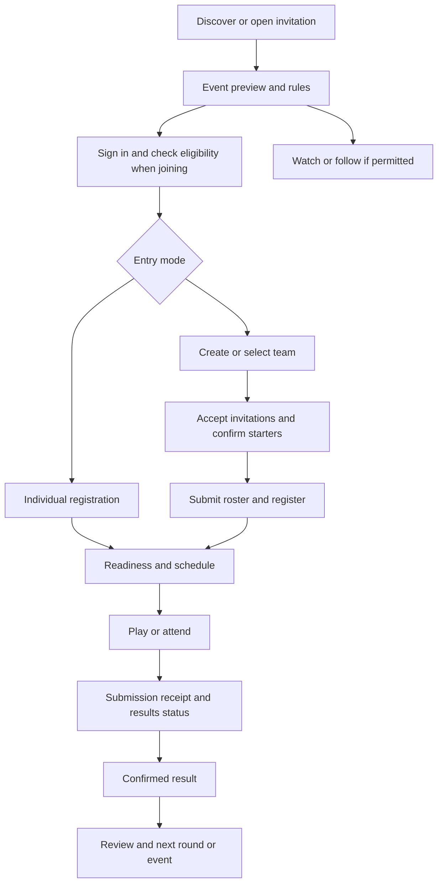

# Complete Arène user and game journeys

Date: October 18, 2026

Status: Proposed behavior, including future modes explicitly labeled below

Companions: [Product rules](PRODUCT-SPEC.md), [Screen design](EXPERIENCE-SPEC.md), [Delivery](IMPLEMENTATION-PLAN.md)

## Journey contract

Every entry point resolves to an event with its real status, the person's role, eligibility and one useful next action. The event is not lost when the person signs in, selects their school, accepts an invitation, backgrounds the app or returns days later.

Watching, following, joining a team, entering an event and checking in are distinct actions with distinct confirmations.

## J01 — Discover a competition or arrive from a shared link

**Person and purpose:** a new or returning student wants to know what is happening and whether they can take part.

1. Enter through Jeux → Arène, `/arena`, a school hub, an invitation or an event reminder. Restore the chosen Arène section, filters and scroll when returning from event details.
2. Show personal obligations first: rejoin an active round, resolve a team invitation or prepare for an entered fixture. A signed-out visitor instead sees genuine public opportunities without a forced profile setup.
3. Explore school, department and national listings. Explain recommendations using known facts such as “Open to NS II at your school.” Let the person change the region manually and view other schools' public competitions.
4. Open an event preview: organizer/trust, subject, entry/game mode, date and duration, online/physical location, eligibility, scoring, visibility, capacity and optional reward provider. Show event-local time with timezone detail and the device-local equivalent if different.
5. The action matches the person's situation: join individually, choose/create a team, request approval, accept an invitation, rejoin, watch, view results or register externally.
6. If joining requires sign-in, preserve the event, division and intended action through authentication and required onboarding. Resume at the pending confirmation, never auto-accept for the student.
7. After joining, show confirmed registration and put the event in “Mes compétitions.” Follow-only users receive schedule updates without appearing on the roster.

**Exceptions:** no school selected does not block public browsing; provide selection only when needed. No eligible events offers broader discovery and genuine practice. Feed failure retains independent practice and personal entries with retry. A restricted event reveals only its authorized preview; expired links show a safe explanation and permitted alternatives. An event becoming full during login returns the student to that event with a clear outcome, not Home.

**Acceptance:** on small phones, a newcomer can identify what the event is, whether they can enter and the next action without confusing public viewing with open registration.

## J02 — Individual live competition

**Person and purpose:** a student enters a school, regional or national individual division without recruiting a team.

1. Confirm eligibility and the public alias that will appear. A school-only event requests membership approval if required; entering a school name does not bypass it.
2. Read a concise rules summary: question count, allowed materials, independent-answer policy, timer, connection behavior, tie-breaks and registration deadline. Confirm entry once; repeated taps/retries return the same registration.
3. The event home shows “Registered,” local start time, reminders, readiness instructions and a practice action with no access to event questions. Returning later opens the same entry.
4. At opening, enter the waiting room. Display server-derived start/phase, connection status and whether the student is ready. An actual delay has an organizer message; waiting for a connection is not labeled an event delay.
5. During each question, read prompt/options, select, submit according to the event's input contract, then see pending → accepted or rejected/expired. Answer receipt does not disclose correctness before the shared reveal.
6. After the deadline, show the released answer and explanation, then confirmed points and permitted standings. Keep standings updates away from active reading/answering.
7. Continue through the declared rounds. After the last answer, show participation receipt while scores settle, then provisional or final results as the source engine supports.
8. The result explains placement, tie-break if applicable and what was earned. Offer corrections when released, the next fixture if entered, or one relevant next event/practice action. The result remains accessible from history.

**Exceptions:** a duplicate submit cannot add points. An ambiguous network timeout says “Checking receipt,” re-reads the submission and offers an idempotent retry if still eligible. Background/resume derives the current server phase; no fresh personal countdown. Late entry follows the published policy and explains missed questions; a closed registration does not offer a misleading Join button. Cancellation leads to a retained event record and follow-up instructions.

**Acceptance:** signed-out link → login → registration → interrupted live play → confirmed result works across native and web without replacing the event or claiming an unconfirmed submission.

## J03 — Individual competition within a window or across rounds

**Person and purpose:** a student participates when their schedule/connectivity allows.

1. Open an entered event and see which round is open, the submission deadline, expected uninterrupted time and completed/upcoming rounds.
2. Before starting, explain that server-timed questions continue when the app is backgrounded. The remaining window must support the applicable finish policy; make that policy explicit rather than promising a full run after the window closes.
3. Start the server-owned attempt. Each served question has its own authoritative deadline. Reopening resumes that attempt and catches up expired questions; it never creates a second attempt.
4. On each answer, show receipt and move to the next server-served question. Preserve the selected option during a recoverable request failure without pretending the server accepted it.
5. On completion, show “Round submitted” and when answers/results become available. Do not reveal answer keys or scores that enable others to infer answers while the round is still open.
6. Return after close for corrections and standings. In multi-round events, lead with the next round and its opening/deadline; cumulative points include only the declared rounds.
7. In existing individual elimination, explain opponent, byes, advancement and the published seed/no-show tie rules. Eliminated students can still watch authorized content and review released work.

**Exceptions:** a closed window stops new questions according to server rules. A missed round is recorded accurately, with its published zero/no-show consequence. If a server response arrives after navigating away, update that attempt's record without hijacking the current screen. Changing accounts never exposes another person's attempt.

**Acceptance:** close the app mid-question and reopen; the same attempt resumes with correct expiry behavior. A finished player's view cannot leak answers to a still-playing participant.

## J04 — Create a team and enter a school-wide competition

**Person and purpose:** a student captain wants to compete with friends against other teams at their school.

1. Open the event and see “Teams of 3 · students of this school · each player answers independently.” Team size, registration/roster deadlines and scoring are visible before creation.
2. Select an eligible existing team or choose “Create a team.” Set an appropriate name, use a polished generated crest, and choose permitted school identity. Avoid requiring custom artwork or a long profile.
3. See a team room with accepted members, pending invitations and three event starter slots. Creating a persistent team does not register it for the event.
4. Invite through a scoped link/code or an approved existing connection. Show pending status. Provide copy/share fallback if native sharing is canceled or fails; do not mark an invitation accepted or delivered solely because the share sheet opened.
5. Members accept team membership. The captain selects three eligible starters, including themselves only if they intend to play. Each starter confirms this event's time and participation.
6. A readiness checklist distinguishes missing people, unaccepted invitations, unresolved eligibility and unconfirmed starters. Offer a structured teammate request if recruitment is enabled; provide no false “ready” state.
7. Submit the roster once. The server checks eligibility, per-event exclusivity and capacity atomically. On success, show registered team, locked/pending-lock roster, next date and reminders. If the event filled during recruitment, retain the team and draft roster, explain the failure and offer another event.
8. Before deadline, a replacement returns the roster to the required confirmation state. At lock, show the exact starters and rules snapshot. Edits to the persistent team afterward do not silently change this event.
9. On game day, open the event team room: “2 of 3 present,” independent start instructions and each person's own Play action. The captain cannot submit another member's answers.
10. Each starter completes the live/window journey. Team status can show neutral receipt/completion progress; teammate correctness and score remain hidden until the relevant reveal/window close.
11. After release, show the team total, each permitted contribution, counting formula and a clear explanation of missing slots. Celebrate the confirmed team result; offer team debrief/released corrections and the next fixture.
12. Keep the team, event-specific roster and earned record for later competitions. “Enter another event with this team” revalidates rules rather than copying an obsolete roster silently.

**Exceptions:** invite revocation, simultaneous invitations, full membership/roster capacity and one starter entering a rival team produce actionable states. A captain losing access uses an authorized transfer/recovery flow. A late missing player contributes zero under the pilot policy; others can still play. No mid-attempt replacement or answer sharing is implied by team membership.

**Acceptance:** one captain and two initially signed-out teammates can form a team, confirm entry, play independently, survive one connection interruption and all return to the same result.

## J05 — Receive a team invitation or find a team

**Person and purpose:** a prospective teammate wants to join without reconstructing the captain's context.

1. Open the invitation on a cold/warm app or browser. Show the inviter's permitted identity, team, relevant event, school restriction, expected commitment and expiration, without exposing a private roster.
2. Sign in if needed; preserve the original invitation and intended event. Allow account switching when a personal invitation belongs to another account. An app installation must not be assumed to preserve browser context automatically; offer the working browser flow or reopenable invitation.
3. The server validates token, recipient/eligibility, revocation and current capacity. The student explicitly accepts or declines. Acceptance creates membership exactly once, not an automatic competition entry.
4. If selected for an event, show its rules and a separate participation confirmation. Explain any deadline and exclusivity conflict; the person resolves the existing entry before joining a rival roster.
5. Land in the team/event room with the next obligation. Subsequent reminders open this room or current fixture directly.

Without an invitation, “Looking for a team” creates an opt-in, school-scoped request tied to the event. Captains send structured invitations. Requests expire at the deadline and can be withdrawn; no public phone/email directory or open chat is required.

**Exceptions:** full, expired, revoked and wrong-account invitations preserve context and explain next steps without revealing restricted membership. A generic reusable recruitment link can require captain approval; it cannot silently let unlimited people into a locked event roster.

**Acceptance:** accepting two competing event invitations concurrently cannot place the same student on two entries in that division.

## J06 — Represent a class or school, including the official championship

**Person and purpose:** a student wants to participate in a collective achievement and understand whether their result counts.

1. Enter through the school hub or an event. Clearly distinguish individual play representing the school, a best-N school score group, a named school squad and a verified classroom entry.
2. Complete the event's actual eligibility checks. For official events, retain their existing registration, school key, grade, consent and integrity requirements; this specification does not reactivate disabled attestation.
3. Before play, explain who counts and how: for example, best five eligible players under that event's frozen rule. Do not reuse a weekly XP position as an official tournament rank.
4. Rejoin through the event card, personal competition list or reminder. Play on the correct engine with its authoritative timing and submission behavior.
5. Results separate personal performance, counted school contribution, participation recognition and school result. Students outside the counting group can still receive truthful participation recognition and a useful next event.
6. If a team/class won, a student who did not compete does not receive an individual champion credential. School-wide pride and personal earned achievements use different labels.

**Exceptions:** pending membership, disputed affiliation, a school merge and a profile school change must not mutate a historical roster. Someone without a school can browse and play unrestricted individual events. Official provisional results retain review status until the official engine finalizes them.

**Acceptance:** the same student can distinguish weekly XP, their custom-team event result and official championship standings on mobile.

## J07 — Organize a competition from creation to closure

**Person and purpose:** a teacher, approved school organizer or student host wants a reliable event, not merely a published card.

1. Choose a starting template: individual class challenge, three-player school team cup, school/grade score-group contest or a supported existing format. School-backed publishing requires the appropriate verified role; informal creation remains available with accurate labeling.
2. Configure participants and eligibility, subject/available question categories, format/time, access and optional reward. Preview expected duration, scoring, deadlines and the participant-facing page. Do not imply curriculum/grade alignment unless the bank supports it.
3. Save a resumable draft, review validation errors inline and publish once. Show publication outcome, audience and actual entry link. Publishing does not automatically accept the host as a participant.
4. Manage entries: eligible/pending/rejected status, complete team rosters, capacity and outstanding confirmations. Approval decisions give a reason and a recovery path without exposing other students' private information.
5. Announce a material schedule/rules change before the permitted freeze. Notify affected entrants and require reconfirmation where needed. Do not silently alter scoring after people begin.
6. At event time, open a role-specific console for readiness/check-in, announcements and a separate projector display. Online auto-scheduled modes continue to use server schedules; a visual “Start” control cannot locally override time.
7. During play, see operational status and permitted participation counts. Active answer keys and hidden individual scores remain server-only. If the host can play, they cannot author/inspect the event's answer set or adjudicate their own disputed outcome.
8. On failure, use a published pause/postpone/void policy. If the mode has no safe server pause, do not offer a cosmetic pause that leaves timers running invisibly.
9. Review permitted results and disputes. App-computed results are not manually rewritten without an audited adjudication mechanism. External scores require their own reporting/confirmation flow.
10. Finalize under the event's governing rules, issue only supported achievements, manage optional reward fulfillment and archive the event. Duplicate its configuration for a future date without copying rosters, private invitations or past rewards as promises.

**Exceptions:** draft recovery, duplicate Publish, question-bank insufficiency, organizer absence, no entries, insufficient valid teams, cancellation and result disputes each have explicit outcomes. If fewer than two valid competing entries remain, label exhibition/no-contest according to rules; do not invent a contested victory.

**Acceptance:** a host can run the full pilot without database editing, a personal developer account or access to confidential answer keys.

## J08 — Watch, follow and explore other competitions

**Person and purpose:** a student, school supporter or guest wants to understand an event and follow a team without entering.

1. Discover a permitted public competition, school or league. A private event appears only through authorized personal context or an approved teaser, never through public result counts or search leakage.
2. Open an audience-appropriate preview. Follow a school/team/event/league separately. Account creation is requested when needed to persist following or access restricted viewing, not to inflate participation.
3. During live play, see event identity, phase, current published question if allowed, followed team/school and authorized standings. Do not reveal hidden per-player scores or private answer choices.
4. Expand standings or inspect another team without losing the current phase. Return to the followed entity in one action. Switching allegiance changes a viewing preference, not profile school or roster.
5. Between phases, show the actual schedule or delay. For windowed rounds, show deadline and permitted completion summaries; no fake live match or early answer reveal.
6. At finish, distinguish provisional from final, and app-computed from organizer-reported results. Follow the next fixture or explore another public league. Shared highlights contain only data the recipient may access.

**Exceptions:** restricted broadcast, removed viewing permission, stale scores, delayed results and nothing live have different explanations. A cached private screen is cleared when authorization ends. Spectator actions never register attendance or increase eligibility counts.

**Acceptance:** a viewer understands who is competing, what phase is current and why a result matters without scrolling past decoration or accidentally entering the event.

## J09 — Join, play and follow a league season

**Person and purpose:** a team or individual wants a recurring competitive story; a league operator needs completed fixtures and trustworthy standings.

1. Open the league: organizer, season, divisions, eligible entrants, fixture cadence, match/league scoring, roster windows, visibility and qualification/reward rules.
2. Enroll an eligible entrant in one division and accept the season commitment. A team captain chooses a permitted season squad; teammates confirm. Fixture-specific lineups remain separate if allowed.
3. The operator publishes fixtures from an explicit schedule, not the current consecutive-round tournament scheduler relabeled as a season. Each entrant gets a “Next fixture” with opponent, format, deadline and readiness.
4. Complete fixture roster/availability confirmation, then use the applicable game journey. A postponement is requested/approved with a new authoritative schedule and participant notification.
5. A confirmed fixture result updates the versioned season table under the published points policy. A disputed/provisional result has visible pending consequences and does not issue a champion or qualification prematurely.
6. Entrants return to the league after each fixture: their standing, games remaining, next opponent and permitted other results. Public spectators can inspect other public divisions without gaining private membership access.
7. Close the season after all required result/dispute gates. Show final placing, ties, qualification and earned records; next-season entry is a new consent/roster decision.

**Exceptions:** withdrawals, no-shows, incomplete schedules, unequal games played, roster changes and corrected results follow published policies. A division with too few entrants is rescheduled/combined only with explicit eligibility and entrant reconfirmation, or canceled. It is not filled with simulated rivals.

**Acceptance:** two real fixtures can progress through a postponement, a disputed result and final recalculation without duplicate league points or an early title.

## J10 — Attend or host an app-supported physical event

1. An approved host publishes the event type, venue visibility, date/time, access needs, device/connectivity requirements and participation rules. An attendee registers individually or through the team journey.
2. Before travel, the student sees confirmed entry, authorized venue details, arrival/check-in time, permitted contact instructions and any required consent status. Organizers provide updates through the event channel.
3. At arrival, a QR/code opens check-in; the scoped host verifies attendance. Show personal attendance receipt. Public spectators cannot inspect individual check-in records.
4. The host opens an audience-only projector display. Participants play their own devices for independent answers; a later shared-answer event uses its declared team-device flow.
5. If connectivity fails, show the actual service state. The online engine does not become an offline scoring system automatically. Apply the published delay/postpone policy; verified offline result capture is a separate later capability.
6. Release results, handle disputes and direct participants to authorized collection of optional physical rewards. Post-event history remains available without publishing private attendance.

**Acceptance:** the host, participant and projector have distinct permissions and usable views; closing the host's phone does not expose controls or halt an otherwise server-scheduled event.

## J11 — Discover an external competition and return to its outcome

1. Open a clearly labeled external event. See activity, verified organizer where applicable, eligibility, schedule, permitted venue details, registration destination and result source.
2. Choose “Register with organizer” or “View instructions.” If registration is external, show “Registration handled externally,” not “Registered” merely because the link opened. A saved/followed event remains findable.
3. Return before the event for instructions and organizer updates. Do not offer an app quiz for an externally judged debate or science project.
4. An authorized host submits results with the event's required attestation/evidence and review path. Participants see organizer-reported, disputed or organizer-confirmed state as applicable.
5. Show the event record and any separately authorized reward status. Results enter a league only after the league's confirmation and comparability checks; external scores never become official national quiz points by default.

**Acceptance:** an external registration handoff or result report is never presented as independently verified app participation or scoring.

## J12 — Shared-answer team play, later release

The event explicitly permits discussion and one answer per team. Before play, the locked roster appoints a submitting captain/device and a deputy. Other members view the same server phase in read-only mode; they cannot create parallel accepted team answers.

For each question: read together → discuss within the authoritative timer → submitting player selects → team submission pending → server acceptance → shared reveal → team score. A submitter transfer requires an authorized server-issued role/version; stale devices lose write authority. A deputy cannot extend the timer or replace a previously accepted answer.

If the device fails, show transfer/rejoin only when supported by the server. If transfer cannot complete before close, record the published timeout outcome. Training includes one short shared-answer practice question. The result credits the locked team without inventing individual answer contributions.

**Acceptance:** two devices racing after a role transfer cannot submit two accepted answers; an old captain's late request cannot overwrite the deputy's valid submission.

## J13 — Relay team play, later release

Before entry, the event declares subject/round slots and how they count. The captain assigns eligible starters to slots; every member sees and confirms their duties. The server freezes the order and controls when each slot opens.

The active player receives the Play action; teammates see progress without hidden questions or answer keys. At handoff, show confirmed completion, next player and the actual next deadline. An offline player invokes only the predeclared substitute/forfeit policy; do not let a stronger teammate take unlimited turns.

Results explain contributions by slot, missed turns and the combined score. In-person relay and distributed asynchronous relay require separate timing policies, not one ambiguous setting.

**Acceptance:** only the assigned eligible player can submit in a slot, and retry/background transitions cannot duplicate or reorder turns.

## J14 — Collect recognition or a reward

After a final eligible outcome, show the exact achievement and issuer. A participant can save/share a permitted result card or certificate without publishing private identity or attendee data.

For a physical/external reward, open the provider's instructions and fulfillment status. Required guardian/consent steps remain private and attributable to the actual provider. Mark “fulfilled” only through the authorized process; a final score does not imply delivery. Provide an event-linked dispute/contact path. An organizer's confirmation is labeled as their report.

**Acceptance:** provisional winners receive no final credential, and failure to collect a reward does not erase the historical sporting result.

## Cross-journey recovery and continuity

| Situation | Required behavior |
| --- | --- |
| Signed-out invitation | Preserve target and intent through sign-in; explicit acceptance afterward |
| App not installed | Working web destination; installation does not falsely promise automatic deferred-link recovery |
| Account switch | Drop prior account's private subscriptions, cached drafts and invitation acceptance context; reauthorize the target |
| Duplicate tap or request retry | Same server-owned entry/answer/roster transaction, no duplicate place or points |
| Slow submission | Immediate pending feedback, slow-state explanation, receipt lookup and safe retry while time permits |
| Reconnect/background/resume | Derive event/attempt phase from server state and deadlines; label cached data |
| Removed membership or viewing rights | Stop private listeners, clear restricted caches and retain only permitted historical/public content |
| Schedule changed | Updated authoritative time, reason and notification; reconfirm affected participation where required |
| Event canceled or not enough entrants | Retained outcome record, no false victory, useful next event/practice action |
| Ambiguous/incomplete results | Pending/provisional state with a real review process; no invented completion estimate |
| Long French/Creole text or large font | Readable rules, options and primary controls; no essential clipping or horizontal dependency |
| Notification cold/warm start | Resolve event, source engine, role and current phase after auth; never land in an unrelated championship |

Validate each launch journey on small iOS/Android phones and supported browsers, with representative tablet/projector review for organizer and spectator flows. Record build/update, backend, participants, interruption and final observable outcome; isolated happy-path screenshots are insufficient.
